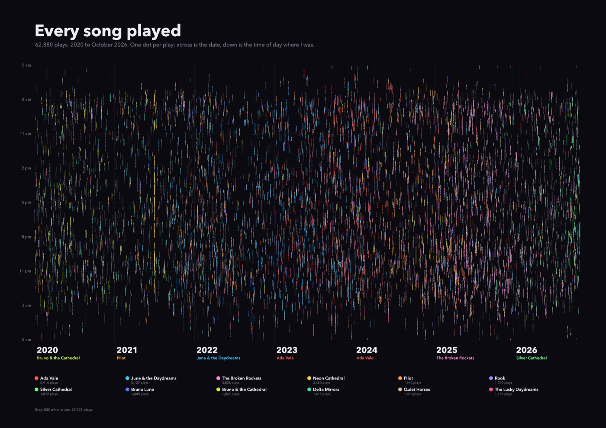
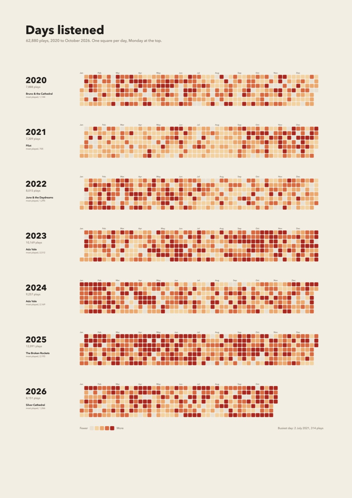
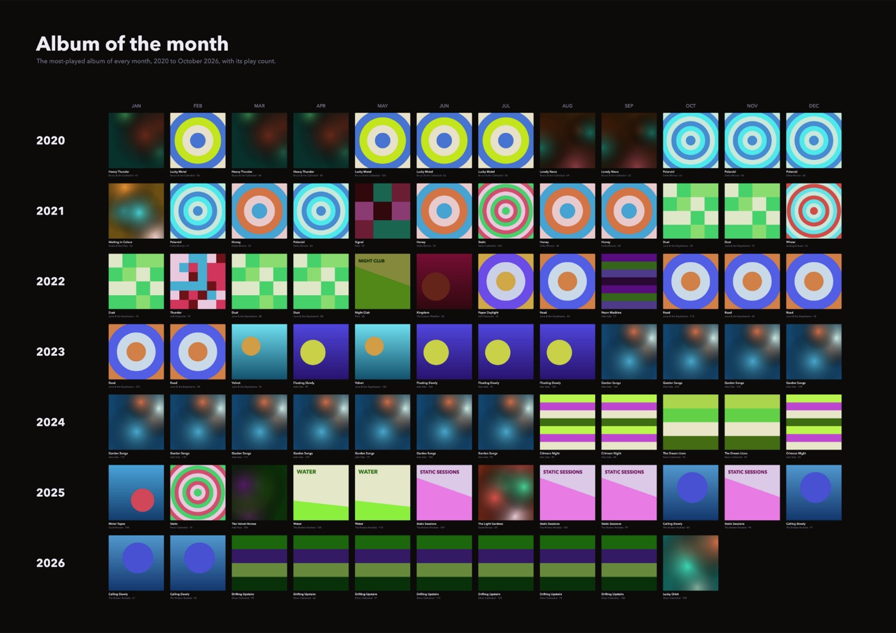
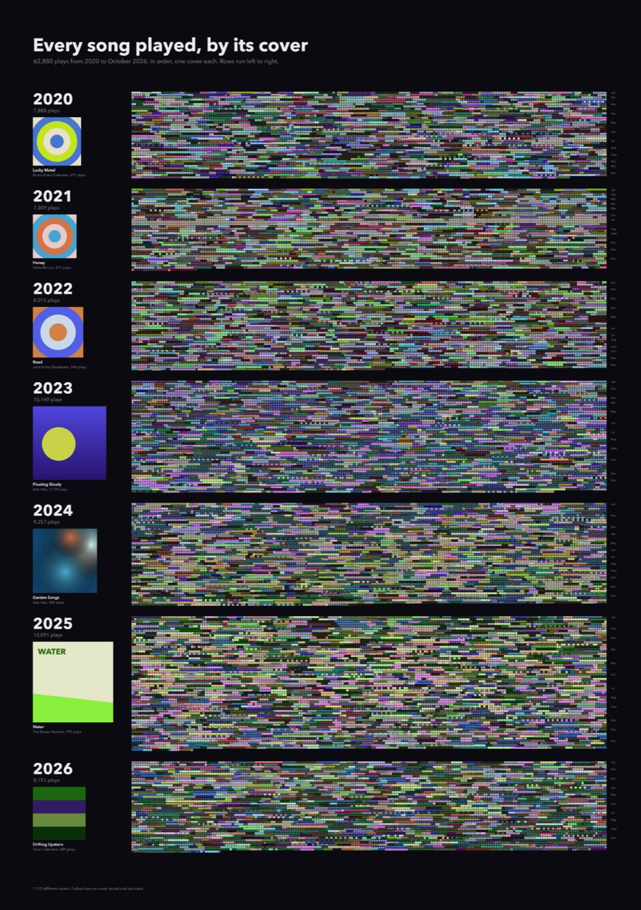

# listening-poster

Turn your Spotify listening history into print-ready posters: every song you've played, drawn four different ways at 300 dpi.

| Dots | Calendar |
|---|---|
|  |  |
| **Album of the month** | **Covers** |
|  |  |

| Poster | Size | What it shows |
|---|---|---|
| `dots` | A2 landscape | Every play as one dot. Across is the date, down is the time of day, and the colour is the artist. |
| `calendar` | A2 portrait | One square per day, shaded by how much you listened, with each year's total and most-played artist. |
| `months` | A1 landscape | The most-played album cover of every month, one row per year. |
| `covers` | A1 portrait | Every play as its album cover, in order, with each year's top album shown large. |

The examples are a real history of about 63,000 plays from 2020 to 2026.

## Quick start

You need [Node.js](https://nodejs.org) 23.6 or later. It runs the TypeScript directly, so there's no build step.

**1. Request your data from Spotify.** Go to your account's [privacy page](https://www.spotify.com/account/privacy/), tick **Extended streaming history** under "Download your data", and confirm the email. Spotify says it can take up to 30 days. You'll get an email with a link to a `.zip`.

**2. Get the code.**

```sh
git clone https://github.com/rcnsh/listening-poster.git
cd listening-poster
npm install
```

**3. Make the posters.**

```sh
npm run posters -- --import ~/Downloads/my_spotify_data.zip
```

That imports the export, downloads the album covers, and writes all four posters to `out/`. Each comes with a small `*-preview.png` for checking on screen. The first run looks up each track's cover once, which takes a few minutes for a big library. Later runs reuse what's already downloaded.

## The `posters` command

```sh
npm run posters -- [poster ...] [options]
```

| Example | What it does |
|---|---|
| `npm run posters` | Remakes all four posters from data you've already imported |
| `npm run posters -- calendar months` | Makes only those two |
| `npm run posters -- --import <zip or folder>` | Imports an export first, then makes all four |
| `npm run posters -- --list` | Shows each poster, its file, and whether its data is ready |
| `npm run posters -- --help` | Lists every poster and option |

The posters are `dots`, `covers`, `calendar`, `months`, or `all` (the default). The options are:

| Option | |
|---|---|
| `-i`, `--import <path>` | Import a Spotify export first: the `.zip`, or the folder it unzips to |
| `-f`, `--fetch` | Fetch from a [music-warehouse](#music-warehouse) instance first, instead of importing |
| `-l`, `--list` | Show what's ready and stop |
| `-h`, `--help` | Show help |

With pnpm, drop the `--`: `pnpm posters calendar --import my_spotify_data.zip`. Each step also has its own script if you want to run it alone:

| Script | Writes |
|---|---|
| `npm run import:spotify -- <path>` | `data/plays.csv`, `data/plays.json`, `data/covers/` |
| `npm run render` | `out/poster.png` (dots) |
| `npm run render:covers` | `out/covers.png` |
| `npm run render:calendar` | `out/calendar.png` |
| `npm run render:months` | `out/months.png` |

## Make it yours

Create `src/config.local.ts`. It's gitignored and merged over the defaults in [`src/config.ts`](src/config.ts), so you only list what you change:

```ts
export default {
  title: "Every song I played",
  footer: "your name · Spotify",

  // Skip a sparse early stretch. Without this, posters start at your first play.
  start: "2020-01-01",

  // Where you were living, each from its date on, so the time of day is local.
  // Without this, this computer's time zone is used throughout.
  // A move is marked on the dots poster.
  timezones: [
    { from: "2000-01-01", tz: "Europe/London" },
    { from: "2024-07-28", tz: "Asia/Singapore" },
  ],

  // Each poster's own settings merge key by key.
  covers: { title: "Every song I played, by its cover" },
  calendar: { title: "Days I listened" },
  months: { title: "Album of the month" },
};
```

You can also change the colours, sizes, backgrounds and font; [`src/config.ts`](src/config.ts) lists every setting. The default font is Avenir Next, which comes with macOS. On Linux or Windows set `font` to one you have installed, or a fallback is used and you'll see a warning.

A day runs from 5 am to 5 am (`dayStartsAt`), so a 1 am play counts for the evening before it.

## What gets counted

- **Songs only.** The import reads every `Streaming_History_Audio_*.json` (`endsong_*.json` in exports from before 2023) and skips the video files. Podcast episodes, audiobooks and local files have no track ID and are left out.
- **No skips.** Plays under 30 seconds are dropped, the same rule Spotify uses for counting a play.
- **One artist per song.** The export names only the album's artist, so featured artists don't appear: a track "by" two artists counts for the album artist.
- **Covers without an API key.** Album names come from the export. Covers come from Spotify's public oEmbed endpoint, looked up once per track and cached in `data/track-covers.json`. If some lookups fail (Spotify rate-limits), run the import again and it carries on where it stopped.
- **The one-year export works too, partly.** Spotify's default "Account data" export (`StreamingHistory_music_*.json`) has no track IDs or albums. It draws the dots and calendar posters, but the cover posters come out blank, so request the extended history if you can.

Your data stays on your machine. The only requests are to Spotify's public cover endpoints, and `data/` and `out/` are gitignored.

## music-warehouse

If you run [music-warehouse](https://github.com/rcnsh/music-warehouse), which keeps your history up to date from Spotify's API, fetch from it instead of importing:

```sh
MW_URL=https://your-instance MW_TOKEN=... npm run posters -- --fetch
```

`--fetch` downloads only what the chosen posters need: `/api/plays.csv` for dots and calendar, and `/api/plays` with covers for the other two. On macOS the token can come from the Keychain entry `music-warehouse-mcp` instead of `MW_TOKEN`. The separate scripts are `npm run fetch` and `npm run fetch:covers`.

## License

[MIT](LICENSE)
